# 区块链基础

> 本笔记记录区块链的核心结构与密码学原理，是后续学习「以太坊 / RPC / 钱包」的地基。
> 所属：[[README|总目录]] · 计划：[[Claude计划]]

## 结构

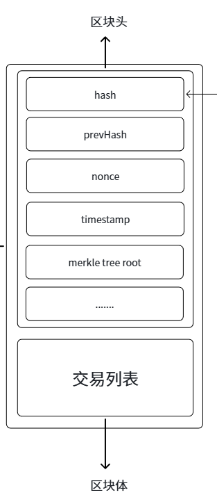

区块链 = 一条由「区块」按时间顺序连接成的链，本质上是一个**只能追加、难以删除的分布式账本**。

- **区块（Block）** = 区块头 + 区块体
  - **区块头（Header）**：存放**前一个区块的哈希**（hash pointer）、Merkle 根（交易列表的哈希摘要）、时间戳、难度目标、nonce 等元信息
  - **区块体（Body）**：存放本区块打包的**交易列表**
- **链（Chain）**：每个区块都记录前一个区块的哈希，从而首尾相连；中间任何一块被改动，后面所有区块的哈希都会对不上，所以环环相扣

## 特性

### 去中心化
区块的产生需要大家的共识

- 没有银行之类的中心机构说了算
- 区块由全网节点共同参与、通过**共识机制**（如 PoW、PoS）达成一致后产生
- 任何单一节点都无法单方面伪造或篡改区块

### 不可篡改
通过共识和 hash 函数

- **hash 函数**：内容一改，哈希值就面目全非 → 篡改会立刻被发现
- **hash 指针**：要改一个区块，必须重算它之后所有区块的哈希，成本极高
- **共识机制**：即便有人重算了，也需掌握全网足够的算力/权益才能让全网接受

### 可追溯
所有数据都是透明的

- 所有交易在链上公开可见，人人可查
- 从任意一笔交易都能一路追溯到创世区块，形成完整可审计的历史

## 密码学原理

### 哈希函数

#### 定义
- **单向不可逆性（One-way / 抗原像攻击）**：正向计算很容易，但给定哈希值，几乎无法反推出原始输入
- **抗碰撞性（Collision resistance）**：难以找到两个不同的输入 x ≠ y，却得到相同的哈希 H(x) = H(y)
  - 注：碰撞客观存在（输入空间远大于输出空间，鸽笼原理），哈希函数要求的是「人为**找不到**碰撞」，而不是「不存在碰撞」

#### 算法
- **MD5**：已不安全，仅作了解
- **SHA-1 / SHA-256**：比特币主要使用 SHA-256
- **Keccak-256**：以太坊用于地址、交易哈希等（注意它和标准化后的 SHA-3 略有差异）

### 对称加密和非对称加密

- **对称加密**
  - 加密与解密用**同一把密钥**
  - 常见算法：DES、3DES、**AES**
  - 特点：速度快；难点是密钥如何安全地传给对方（**密钥分发问题**）
- **非对称加密**
  - 密钥**成对**出现：公钥（可公开）+ 私钥（保密）
  - **公钥加密 → 私钥解密**：保证数据的机密性
  - **私钥签名 → 公钥验签**：证明身份与来源（即**数字签名**）
  - 常见算法：RSA、ECC（椭圆曲线）；区块链使用椭圆曲线 **secp256k1**（ECDSA）
  - 特点：解决密钥分发问题，但比对称加密慢；工程上常用「非对称加密传递对称密钥 + 对称加密传数据」的组合

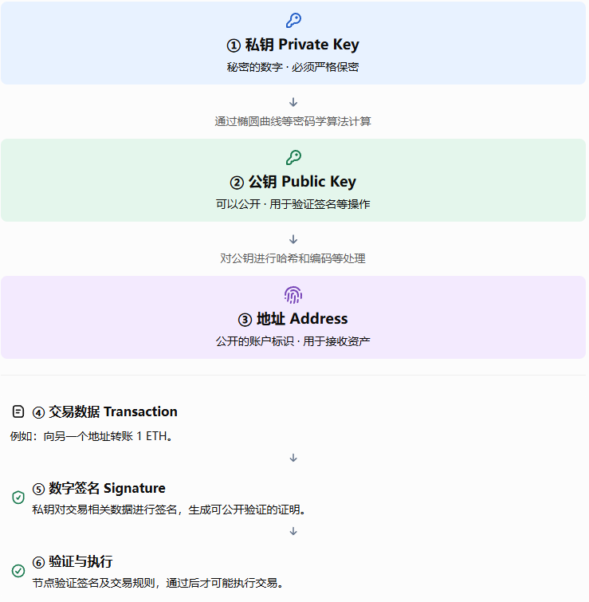

### 门限共享与门限签名

#### 1. 门限共享

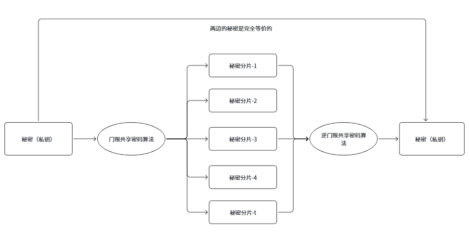

把一个秘密拆成 **n** 份分片（share），任意 **t** 份（t ≤ n）即可恢复出秘密；少于 t 份则得不到任何信息。

- 底层基于**多项式算法**：即 Shamir 秘密共享——用一条 t−1 次多项式，把秘密放在常数项，再取 n 个点作为 n 份分片
- 作用：避免秘密集中在一处（单点故障），也避免秘密丢失后无法找回

#### 2. 门限签名

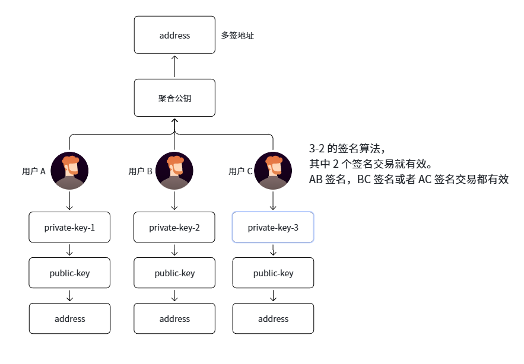

由 n 个参与者共同生成一个**聚合公钥**，设定其中任意 k 个（k ≤ n）参与者的签名即可合成一个**有效签名**。

- 私钥从不集中在任何单一方手里，单个参与者无法单独签名
- 与门限共享的关系：门限共享解决「秘密怎么拆」，门限签名解决「签名权怎么分散」

#### 3. 基于密钥的社交恢复方案

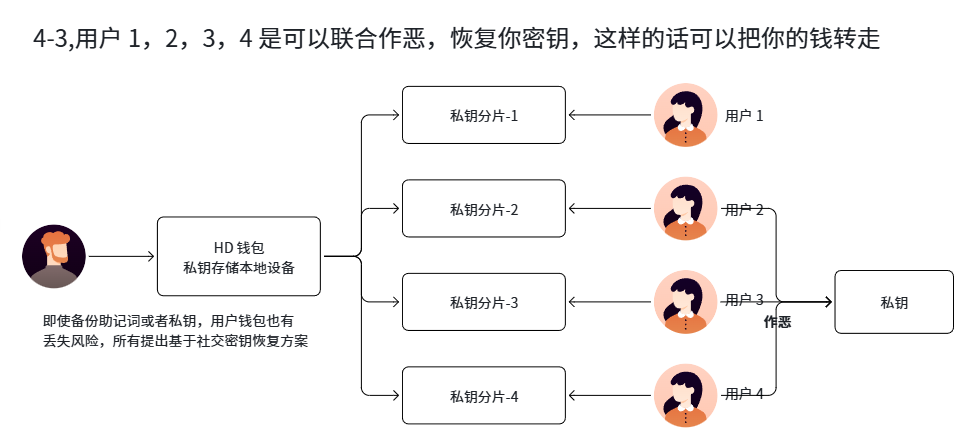

**云端抗干扰的秘密丢失方案**：

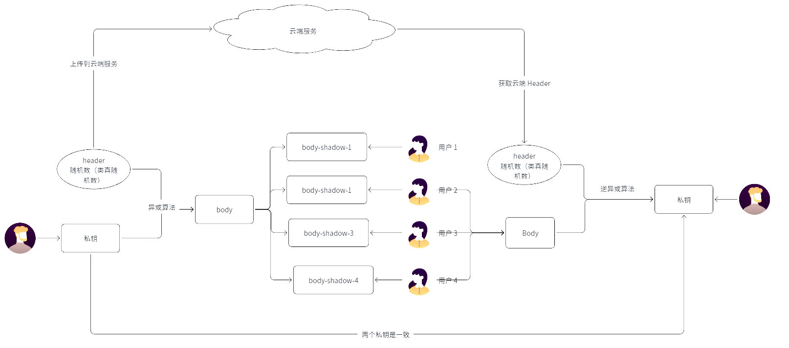

### MPC 算法

**基本概念**：网络中多个节点通过**多轮 P2P 通信交互**，各自在自己的节点上生成对应的**密钥分片**；整个过程中，**完整的私钥从未在网络上出现过**。这也是一种门限签名方式。

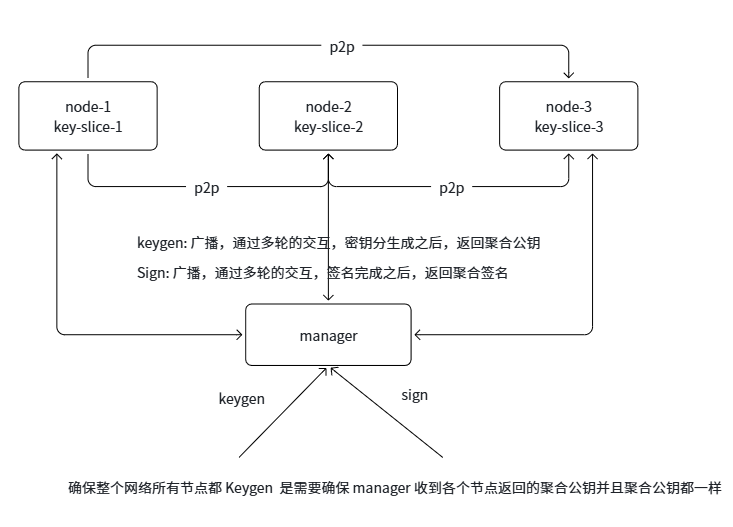

- 算法底层基于 **ECDSA 和 EdDSA**，通过分布式的方式产生密钥和签名（即 threshold ECDSA / EdDSA）
- 与普通门限签名的区别：MPC 强调「从密钥生成到签名全程分布式」，不存在先有单点拿到完整私钥再拆分的过程，因此更安全

### BLS 签名算法

**简介：签名可聚合。**

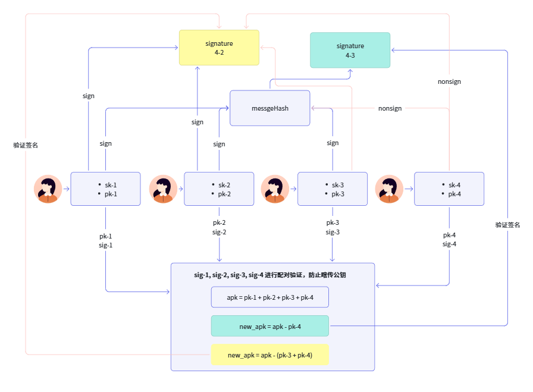

- BLS（Boneh–Lynn–Shacham）是一种基于**双线性配对（pairing）**的签名方案
- 核心优势：多个签名可以**聚合**成一个很短的签名，验证时也只需一次配对，非常适合多签 / 大批量签名验证
- 应用：以太坊 PoS 共识（验证者签名聚合）

### Schnorr 签名

优点：

- **高效性**：验证快，且支持批量验证
- **短签名**：签名体积小
- **安全性**：在随机预言机模型下有严格的安全性证明，且没有 ECDSA 的「签名延展性」问题
- 额外优势：支持**签名聚合**（如 MuSig），多个签名可合成一个
- 应用：比特币 Taproot 升级引入 Schnorr 签名

### 总结

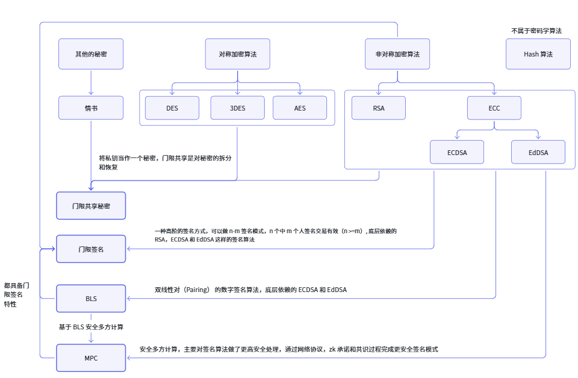

| 签名方案 | 核心特点 | 典型用途 |
|---|---|---|
| ECDSA | 应用最广、成熟 | 比特币 / 以太坊账户签名 |
| Schnorr | 短、可聚合、无延展性 | 比特币 Taproot、MuSig 多签 |
| BLS | 可聚合、批量验证 | 以太坊 PoS、多签聚合 |
| 门限签名 / MPC | 签名权分散、无完整私钥 | 机构托管钱包、社交恢复 |

## 数据结构

### Merkle 树

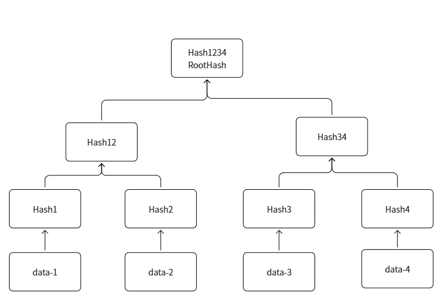

**不断两两 Hash，最终得到一个根 hash（Merkle Root）。**

- 叶子节点：存放数据（通常是交易的哈希）
- 内部节点：存放其子节点哈希的哈希
- 应用场景：
  - **交易防篡改**：根 hash 变了，说明有数据被改动
  - **验证某一个数据是否存在**：只需 O(log n) 个哈希即可做 Merkle Proof，无需下载全部数据

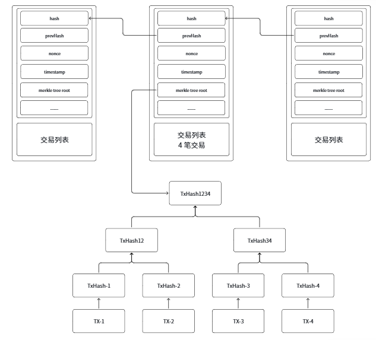

### 前缀树

**1. 基本概念**

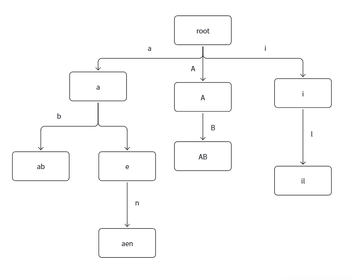

前缀树（Trie / 字典树）：按 key 的字符逐层向下分支，共享前缀的 key 共用同一条路径。

**2. 优缺点**

优势：

- 查询拥有**共同前缀**的 key 十分高效

缺点：

- 查询/插入/删除的复杂度是 **O(key 长度)**，与 key 总数无关（不是 O(n)）
- **key 比较长时会造成空间浪费**（节点多、分支稀疏）
